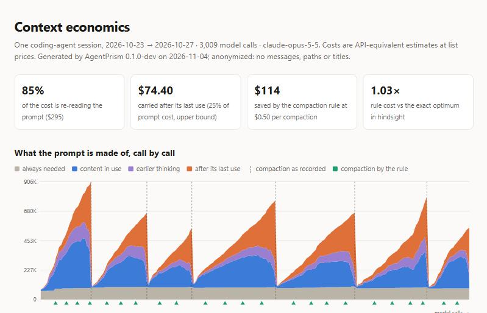

# AgentPrism — where an AI coding agent's money goes

AgentPrism reads the local logs of Claude Code and shows what the agent pays for: the cost of each step, the share spent re-sending the history, the context blocks carried after their last use, and when compacting the context actually pays off. Everything is computed locally. Logs never leave your computer, and the database stores no message texts or file contents.



## What the real logs showed

Data: 12 days of work by several agents on one machine, cut at 2026-11-04. Money values are API list-price equivalents, not an invoice. Method and caveats: [docs/FINDINGS.md](docs/FINDINGS.md) and [docs/RESEARCH.md](docs/RESEARCH.md) (the research log is still in Russian; an English translation is pending).

- About 85% of the main chain's cost is re-sending past context (cache reads about 65%, cache writes about 20%).
- About 21% of the prompt cost goes to blocks carried after their last use. This is an upper estimate under a liberal rule; the rule's accuracy has not been measured.
- A simple compaction rule (modeled on the ski-rental problem) stayed within 4–16% of the optimum computed over the whole session, when the "forgetting" price is set correctly. With a wrong price, the loss reaches 2.5x.

## Architecture

```
Claude Code logs (~/.claude/projects, JSONL)
        │  adapter-claude-code: parsing, prices by cache TTL
        ▼
   packages/core ── loss detectors (11) · price registry · context registry · compare / switchback
        │                          │
        ▼                          ▼
   SQLite (tokens, cost,          packages/cli: terminal reports, --json, --html
   tool names, hashes)            packages/sdk: traces of your own LLM calls (adapter-traces)
```

Packages in `packages/`: `core`, `adapter-claude-code`, `adapter-traces`, `sdk`, `cli`. See [docs/ARCHITECTURE.md](docs/ARCHITECTURE.md) for the design and [LOG_FORMAT](docs/LOG_FORMAT.md), [TRACE_FORMAT](docs/TRACE_FORMAT.md), [CORRECTIONS_FORMAT](docs/CORRECTIONS_FORMAT.md) for the formats.

## Install from zero (Windows, macOS or Linux)

You need:

- [Git](https://git-scm.com/downloads)
- [Node.js](https://nodejs.org/) 22.13 or newer (LTS). On Windows, use the installer from nodejs.org and open a new terminal afterwards.

Steps (PowerShell on Windows, or any shell on macOS/Linux):

```bash
git clone https://github.com/zhichkin44-del/agentprism.git
cd agentprism
npm install
npm run build
node packages/cli/dist/index.js --root packages/adapter-claude-code/test/fixtures/projects --db .agentprism-try.db
```

The last command runs the report on the bundled test logs, so you can see the output without any personal data.

To use your own logs (read from `~/.claude/projects`):

```bash
npm link -w packages/cli    # puts the `agentprism` command on your PATH
agentprism                  # costs, expensive sessions, main findings
agentprism context          # context economics of the last session, when to compact
agentprism context --html r.html   # a self-contained page with no texts, paths or titles
agentprism findings         # loss detectors: evidence, cost estimate, what to fix
agentprism compare          # did it get cheaper after your change: interval and an honest verdict
```

Add `--json` to any command for machine-readable output. `--plugin ./my-plugin.mjs` loads your own detectors and adapters.

## Tests

```bash
npm test          # unit tests (Vitest)
npm run check     # lint, typecheck and tests
```

Verified on 2026-11-21 on Windows 11 with Node.js 24 in a clean clone: 61 tests in 11 files pass; `npm run typecheck`, `npm run lint` and `npm run build` pass. The CI workflow (`.github/workflows/ci.yml`) runs the checks on Ubuntu, Windows and macOS with Node 22 and 24.

## Limits

- Cost is an estimate at API prices as of 2026-10-06, not an invoice. On a subscription, the figures show relative weight only.
- "After last use" is an upper estimate: use is judged by meaning, and there is no shared identifier to check it.
- On one person's logs, a plain before/after comparison proves very little (the work itself drifts). `compare` corrects for this and reports "no clear change" when that is the case. To prove an effect, use `agentprism switchback`.
- Only Claude Code is supported; other agents can be added through adapters.
- The findings come from one user's logs covering 12 days.

## License

MIT
